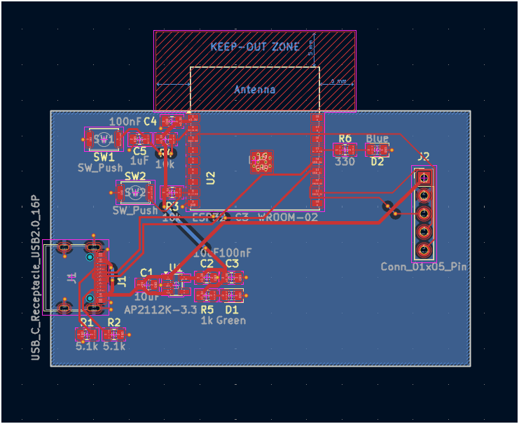
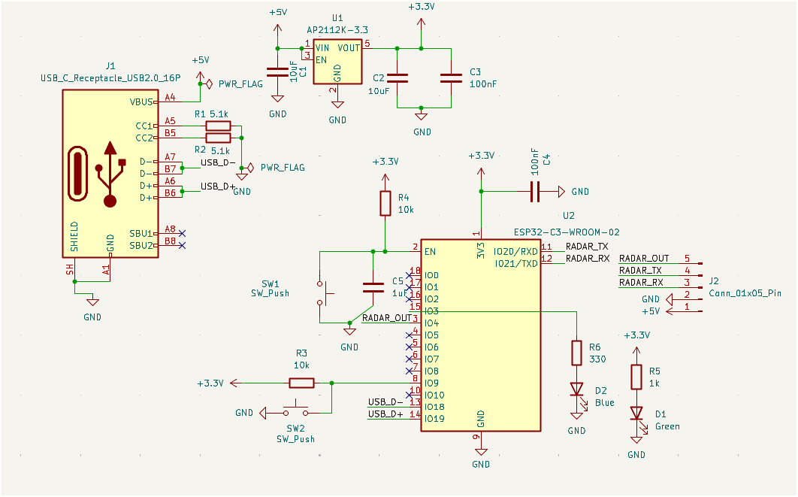
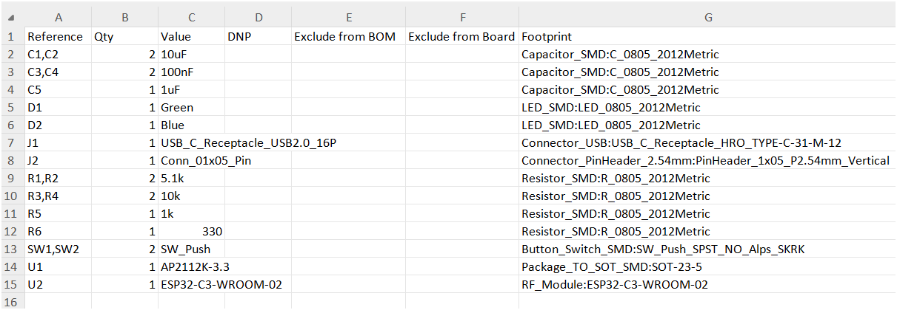
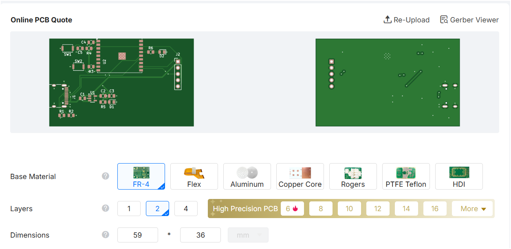

# 24 GHz Radar Sensor Controller PCB


A custom-designed, 2-layer radar sensor controller PCB developed using KiCad, featuring an ESP32-C3 microcontroller and an expansion interface for 24 GHz FMCW radar modules.
|


This project was an opportunity to explore electronic design automation (EDA), schematic design, PCB layout, component selection, and manufacturing preparation.


## Project Overview


The board is designed to act as a controller and interface for a 24 GHz radar sensor module. It uses an ESP32-C3 microcontroller and includes power regulation, status indicators, user-control buttons, and an expansion header.


The design was developed in KiCad, from schematic capture to PCB routing and manufacturing-file generation.


## Project Gallery


### 3D PCB Renders


### PCB Layout





### Schematic





### Bill of Materials





### Manufacturing Verification





## Technical Specifications


| Feature | Description |

|---|---|

| Microcontroller | ESP32-C3 |

| Architecture | 32-bit RISC-V |

| Radar Interface | Expansion header for compatible 24 GHz FMCW radar modules |

| Example Radar Module | Hi-Link HLK-LD2410 |

| Power Input | USB Type-C, 5V |

| Operating Voltage | 3.3V regulated |

| PCB Layers | 2 |

| Design Software | KiCad |

| PCB Manufacturer Verification | JLCPCB |


## Key Features


- USB Type-C power input.

- 5V to 3.3V voltage regulation.

- ESP32-C3 microcontroller.

- Status and target-detection LED indicators.

- Reset and boot buttons.

- Expansion header for compatible radar modules.

- Two-layer PCB design.


## Design and Engineering


The project involved several stages of electronic hardware development:


### 1. Schematic Design

- Component selection and placement.

- Power distribution design.

- Microcontroller connections.

- Peripheral and expansion-header connections.


### 2. PCB Layout

- Component placement and board organisation.

- Signal routing across two copper layers.

- Ground-plane and power-distribution considerations.

- Design-rule checking (DRC).


### 3. Manufacturing Preparation

- Gerber file generation.

- Bill of Materials (BOM) export.

- Fabrication-file verification through JLCPCB.


## Design Verification


The completed KiCad design achieved:


- 0 DRC errors.

- 0 DRC warnings.

- 0 unconnected items.


The exported Gerber files were also submitted to JLCPCB's automated verification system.


These results indicate that the design passed the checks performed at this stage. Physical fabrication, assembly, electrical testing, and radar-module integration have not yet been completed.


## Repository Structure


```text

24GHz-Radar-Sensor-Controller-PCB/

│

├── Hardware/

│   ├── KiCad_Project/

│   │   ├── radar-controller.kicad_pcb

│   │   ├── radar-controller.kicad_pro

│   │   └── radar-controller.kicad_sch

│   │

│   ├── Schematics/

│   ├── PCB_Layout/

│   └── 3D_Models/

│

├── Manufacturing/

│   ├── Gerber_Files/

│   ├── BOM/

│   │   └── radar-controller.csv

│   └── Drill_Files/

│

├── Documentation/

│

├── Images/

│   ├── 3D View 1.png

│   ├── 3D View 2.png

│   ├── PCB.png

│   ├── Schematic.png

│   ├── BOM.png

│   └── JLCPCB.png

│

└── README.md

```


## Future Improvements


The next stages of development include:


- Physically fabricating and assembling the PCB.

- Testing the 5V input and 3.3V power regulation.

- Verifying ESP32-C3 operation.

- Integrating a compatible 24 GHz radar module.

- Developing firmware for radar data acquisition and processing.

- Testing the complete system under real operating conditions.


## Learning Experience


This was my first PCB design project, and I began with only a basic understanding of electrical and electronic concepts.


Throughout the process, I explored schematic capture, component selection, PCB routing, design-rule checking, and manufacturing preparation.


I also used Google Gemini as an interactive learning assistant to understand unfamiliar concepts and troubleshoot design decisions. The schematic design and PCB routing were carried out by me.


The project helped me develop a practical understanding of how electronic hardware moves from an initial concept to a manufacturable PCB design.


## Tools and Technologies


- **KiCad** — Electronic design automation and PCB layout.

- **ESP32-C3** — Microcontroller.

- **USB Type-C** — Power input.

- **24 GHz FMCW Radar** — Intended sensor interface.

- **JLCPCB** — Manufacturing-file verification.

- **Google Gemini** — Interactive learning assistance.


---


*This repository documents the design and manufacturing preparation stages. Physical hardware validation is still pending.*

